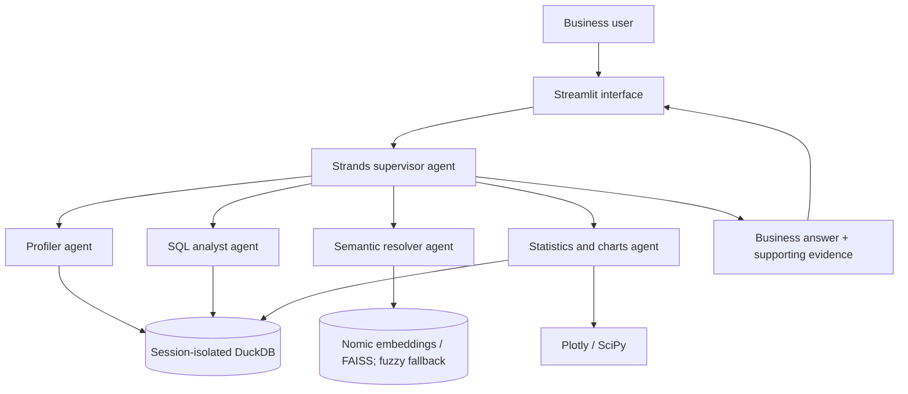

# ⚡ Tabular Intelligence

**Conversational analytics for CSV and Excel, powered by Strands Agents SDK, Amazon Bedrock, DuckDB, FAISS, SciPy, Plotly, and Streamlit.**

> Status: historical multi-agent MVP. Oracle connectivity is planned, **not yet implemented** in this source snapshot.

## What it does

Upload CSV/XLSX/XLS files (up to 15 MB), ask analytical questions in plain language, and inspect grounded answers, supporting tables, interactive charts, and downloadable CSV results.

## Architecture



## Quick start

```bash
git clone https://github.com/Xenaquas/Tabular-Intelligence.git
cd Tabular-Intelligence
python -m venv .venv
# Windows: .venv\\Scripts\\activate
pip install -r requirements.txt
```

Copy `.env.example` to `.env`, configure your own AWS Bedrock credentials or IAM role, and start the optional local Nomic embedding endpoint if needed. Then run `streamlit run app.py`.

**Do not commit `.env`, tokens, or production datasets.** An existing credential was detected in the supplied archive; rotate it before public release.

## Documentation

- [Technical architecture and implementation notes](TECHNICAL.md)
- [Application entry point](app.py)
- [Supervisor agent](core/agents/supervisor.py)
- [Analytical engine](core/db_engine.py)
- [Benchmark dataset](data/retail_sales_sample.csv)

The source files and technical document are being prepared for publication. Links to them will work once those files are uploaded.

## Scope

The supplied code implements a Strands supervisor with profiler, semantic, SQL, and statistics/chart specialist agents. It currently analyzes uploaded tabular data using in-memory DuckDB. **Oracle integration, multi-table enterprise SQL, authentication, and production governance are future work.**

## Tests

`python test_verification.py` and `python test_bedrock_integration.py` (requires appropriately configured AWS credentials). No claim of passing tests is made without running them.

## License

No license has been granted in this repository. Add a license only after the owner chooses one.
