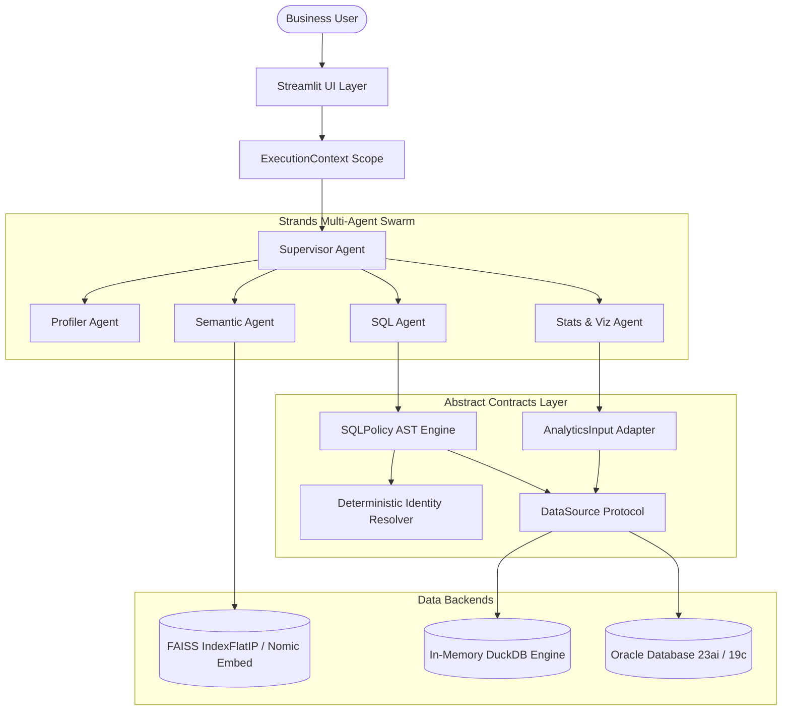

# Tabular Intelligence

Conversational tabular analytics over spreadsheets (CSV/Excel) and live enterprise databases (Oracle) using **Streamlit**, **Strands Agents SDK**, **Amazon Bedrock**, **DuckDB**, **FAISS / Nomic**, **SciPy**, and **Plotly**.

A coordinated multi-agent swarm translates natural-language business questions into AST-validated SQL queries, statistical distribution profiles, and interactive visualizations.

---

## 1. What the Application Does

Tabular Intelligence enables business and data analysts to interrogate complex datasets without writing SQL or code:
- **Dual Data Source Support**: Upload ad-hoc CSV / Excel files for immediate in-memory DuckDB querying, or connect directly to an on-premises Oracle database (`python-oracledb`).
- **Autonomous Multi-Agent Swarm**: A central Strands Supervisor coordinates specialized agents for profiling, semantic entity resolution, secure SQL generation, and statistical visualization.
- **Deterministic Disambiguation**: Intercepts ambiguous inquiries (e.g., multiple people sharing the same name) and demands explicit user clarification before executing dependent queries.
- **Database-Level Immutability**: Enforces read-only database execution (`SET TRANSACTION READ ONLY`) and AST-based SQL validation that rejects DDL, DML, and injection attacks.
- **Decoupled Architecture**: Statistical and chart tools operate against abstract `DataSource` contracts, providing identical analytical capabilities across DuckDB and Oracle.

---

## 2. High-Level Architecture



---

## 3. Strands Multi-Agent Swarm

| Agent Role | File Path | Specialist Responsibility |
| :--- | :--- | :--- |
| **Supervisor Agent** | [`core/agents/supervisor.py`](core/agents/supervisor.py) | Coordinates tool delegation, maintains conversational context, and enforces out-of-scope refusals. |
| **Profiler Agent** | [`core/agents/profiler_agent.py`](core/agents/profiler_agent.py) | Analyzes table schemas, missing value percentages, column types, and distinct value distributions. |
| **Semantic Agent** | [`core/agents/semantic_agent.py`](core/agents/semantic_agent.py) | Resolves natural-language entity names to physical database primary keys via local FAISS embeddings. |
| **SQL Agent** | [`core/agents/sql_agent.py`](core/agents/sql_agent.py) | Formulates dialect-compliant SQL queries and self-heals syntax or schema errors via feedback loops. |
| **Stats & Viz Agent** | [`core/agents/stats_agent.py`](core/agents/stats_agent.py) | Computes parametric/non-parametric statistics, detects outliers (IQR/Z-score), and renders Plotly charts. |

---

## 4. Technology Stack

- **Frontend**: Streamlit 1.35+
- **Agent Orchestration**: Strands Agents SDK 1.25.0
- **Database Engines**: DuckDB 1.2.0 (local files) & Oracle Database 23ai/19c via `python-oracledb` 26.1.0 (Thin Mode)
- **Vector Search**: FAISS (`IndexFlatIP`) with local Nomic Embed (`nomic-ai/nomic-embed-text-v2-moe-GGUF`)
- **SQL Security & AST**: `sqlglot` 27.29.0
- **Primary Model Provider**: Amazon Bedrock (Anthropic Claude 3.5 Haiku, Claude Haiku 4.5)
- **Secondary Model Provider**: OpenRouter (`openai/gpt-4o-mini`, `anthropic/claude-3.5-haiku`)
- **Statistical Computing**: SciPy 1.15.0 & NumPy 2.2.0
- **Visualizations**: Plotly 6.0.0

---

## 5. Quick-Start Installation

### Prerequisites
- Python **3.12 or newer**
- `uv` **0.11.21**

```powershell
# 1. Clone repository
git clone https://github.com/Xenaquas/Tabular-Intelligence.git
cd Tabular-Intelligence

# 2. Install dependencies with locked hashes
python -m pip install uv==0.11.21
uv sync --locked

# 3. Configure environment
Copy-Item .env.example .env

# 4. Launch Streamlit UI
uv run streamlit run app.py
```

The application opens at `http://127.0.0.1:8501`.

---

## 6. Verified Test & Benchmark Summary

```
======================================================================
TOTAL AUTOMATED TESTS EXECUTED: 113
PASSED: 113 | FAILED: 0 | SKIPPED: 0 | VERIFIED 100% REPRODUCIBLE
======================================================================
```

- **Offline Test Suite** (`pytest tests/offline`): **105 passed in 8.30s** (network blocked by `pytest-socket`, `.env` loading disabled).
- **Oracle Integration Suite** (`pytest tests/integration/test_oracle_integration.py --run-oracle`): **8 passed in 3.28s** (real live connection to local Oracle 23ai Free).

---

## 7. Visual Tour

| Viewport / Step | Preview |
| :--- | :--- |
| **Desktop Canvas (1920x1080)** |  |
| **Oracle Data Source Mode** |  |
| **Plotly Analytics Canvas** |  |

---

## 8. Complete Documentation Index

- [`docs/PROJECT_CONTEXT.md`](docs/PROJECT_CONTEXT.md): Project origin, roadmap, and protected invariants.
- [`docs/ARCHITECTURE.md`](docs/ARCHITECTURE.md): Detailed system design, data contracts, and Mermaid diagrams.
- [`docs/WORKFLOW.md`](docs/WORKFLOW.md): Sequence diagrams for ingestion, querying, and error recovery.
- [`docs/USER_FLOW.md`](docs/USER_FLOW.md): Walkthrough of user workflows with screenshots.
- [`docs/DATA_FLOW.md`](docs/DATA_FLOW.md): Data lineage, truncation guards, and inference privacy boundaries.
- [`docs/FEATURES.md`](docs/FEATURES.md): Comprehensive feature inventory and test coverage matrix.
- [`docs/DATABASE_INTEGRATION.md`](docs/DATABASE_INTEGRATION.md): Oracle Thin mode, catalog discovery, and ground truth.
- [`docs/MODEL_PROVIDERS.md`](docs/MODEL_PROVIDERS.md): Amazon Bedrock primary and OpenRouter secondary configurations.
- [`docs/DATA_TYPE_SUPPORT.md`](docs/DATA_TYPE_SUPPORT.md): Data type compatibility matrix across all engines.
- [`docs/SECURITY.md`](docs/SECURITY.md): Multi-layer defense, AST rules, and session isolation.
- [`docs/TESTING_AND_BENCHMARKS.md`](docs/TESTING_AND_BENCHMARKS.md): Reproducible test evidence and latency figures.
- [`docs/DEPLOYMENT_AND_SETUP.md`](docs/DEPLOYMENT_AND_SETUP.md): Step-by-step setup and Oracle provisioning guide.
- [`docs/KNOWN_LIMITATIONS.md`](docs/KNOWN_LIMITATIONS.md): Operational boundaries and future tasks.
- [`docs/evidence/EVIDENCE_INDEX.md`](docs/evidence/EVIDENCE_INDEX.md): Index of test screenshots and empirical logs.
- [`AGENTS.md`](AGENTS.md): Onboarding and instruction manual for future AI coding agents.
