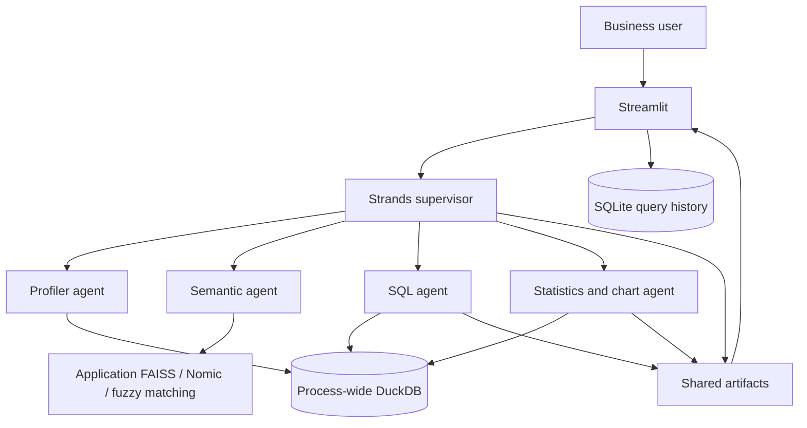

# Technical architecture — Tabular Intelligence

## Current execution path

The supervisor uses four delegation tools, each constructing a specialist agent.
Delegation instructions and responses are strings. This is model-driven routing,
not a deterministic sequence that guarantees schema inspection or SQL execution.
Specialists also communicate through the process-wide artifact store.

## Active modules

| Component | Files and behavior |
|---|---|
| UI | `app.py`: session variables, built-in benchmark, upload parsing, supervisor invocation, answer/table/chart/export rendering |
| Supervisor | `core/agents/supervisor.py`: four delegation tools, shared model context, per-turn artifact reset |
| Specialists | `core/agents/{profiler,semantic,sql,stats}_agent.py` |
| Models | `core/agents/llm_factory.py`: Bedrock via boto3/STS; `get_openrouter_model` is a compatibility alias |
| Analytical storage | `core/db_engine.py`: singleton DuckDB, column cleaning, table registration, SQL, post-fetch 5,000-row cap |
| Tool execution | `core/tools/{profiling,sql,stats,viz}_tools.py` |
| Semantics | `core/semantic_index.py`, `core/nomic_embeddings.py`: categorical values, FAISS/Nomic then RapidFuzz/substring fallback |
| Artifacts | `core/tools/artifact_store.py`: last SQL/DataFrame/chart/error, traces and listeners |
| Persistent metadata | `core/metadata_store.py`: SQLite catalog and prompt/SQL history, without requester ownership or expiry |
| Runtime/config | `core/runtime.py`, `core/__init__.py`, `config.py`: Python 3.12+ gate and environment settings |

Streamlit session variables reference shared objects; they do not establish data
isolation. The semantic agent's current index and supervisor configuration are
module globals. The supervisor receives the table name and question, not a governed
schema catalog. Agents, tools and the model factory retain legacy fallback logic.

Ingestion cleans DuckDB headers but builds semantics from the original DataFrame.
The SQL tool returns a 15-row text preview, while the engine fetches the full query
result before truncating it to 5,000 rows. Several statistical tools consume this
truncated result without declaring incompleteness. Charts without explicit SQL
may select 2,000 rows or reuse an earlier DataFrame.

## Preserved legacy and auxiliary modules

`core/pipeline.py`, `core/sql_agent.py`, `core/ingestor.py`, and
`core/schema_manager.py` belong to the earlier SQLite/LangChain path. They import
undefined `SETTINGS`; some also import nonexistent `SemanticIndex`. They are not
reachable from the current Streamlit application and remain in place for owner
review. Baseline checks compile them but do not claim they import or work. No
`SETTINGS` shim or legacy-only dependency was added to hide these defects.

`core/output_schemas.py` is importable but is not an enforced result contract.
`demo_live_swarm.py` imports safely but still supplies DeepSeek/OpenRouter-era
model IDs to the Bedrock-backed factory. Its live behavior is unverified.

## Review reconciliation at Phase 0A

Inspected against `main` commit `4efe8df` and the
[28 October Code Review](https://docs.google.com/document/d/1Wg5kXgl6rvIM-r_1q9XR8fellaXQbL_3QUjd9UXiD58/edit).

| Review finding | Current status / next gate |
|---|---|
| P0 unrestricted SQL, raw identifiers, external access | Verified unresolved; Phase 0B-1. No centralized parser/policy or database restrictions exist yet |
| P0 shared database/artifacts/index/model context | Verified unresolved; Phase 0B-2 |
| P1 unstated Python requirement | Addressed by metadata, runtime gate, setup instructions, and version tests in Phase 0A |
| P1 silent analytical truncation | Verified unresolved; Phase 0C; strict expected-failure fixture |
| P1 same-model fallback / stacked retries | Verified unresolved; no bounded application-wide retry budget introduced |
| P1 specialist failures treated as success | Verified unresolved; Phase 0C. Ordinary SQL failures can leave artifact `error=None` |
| P1 header mismatch | Verified unresolved; Phase 0C |
| P1 ingestion errors / replacement | Still unresolved in application code. Missing XLS reader dependency supplied in Phase 0A; parsing/replacement fixes remain Phase 0C |
| Unpinned dependencies / missing RapidFuzz | Addressed by uv lock/export and explicit dependencies in Phase 0A |
| Misleading test banners / live calls during import | Replaced with assertion-based offline tests and opt-in live tests |
| False documentation safety/isolation claims | Removed; these capabilities remain future work |
| Credential revocation, full runtime, accessibility | Not verified by this baseline |

The missing-discount ingestion crash also remains a strict expected failure.
Other review findings (raw error/HTML rendering, resource limits, chart provenance,
retention, embedding behavior and UI labeling) are not repaired by Phase 0A.

## Configuration and validation boundaries

All agents default to the configured Bedrock model; fallback currently uses the
same model. STS failures fall back to direct/default credentials with a warning.
Model availability, permissions and role refresh have not been verified live here.
`MAX_SQL_RETRY` and `MAX_CATEGORICAL_CARDINALITY` are not wired into the active
execution paths; do not interpret them as enforced limits.

Tests disable local dotenv loading and sockets during collection as well as normal
execution. Fixtures own temporary SQLite handles and DuckDB connections. This
test-only ownership is not a repair of production session isolation.

`scripts/check_baseline.py` compiles repository sources without traversing `.venv`
or generated data, then imports runtime dependencies and active core modules with
sockets blocked. It verifies real Strands/Bedrock classes are available. It does
not execute Streamlit's top-level UI or invoke models. See [evidence](docs/phase-0a.md).

## Future Oracle boundary

No Oracle driver, connection, schema fixture, authorization service or query agent
is added in Phase 0A. Later work must preserve the existing supervisor and use a
separate restricted backend, governed relationship catalog, template-first entity
lookup/clarification, validated bind queries, and owned evidence.

Compatibility targets: 19c/21c/23ai primary; 12.1/12.2 conditional on driver and
dialect tests; 11.2 conditional on a separately verified Thick-client setup. Runtime
compatibility must be established on each actual database version. ROWNUM-compatible
limits are the legacy baseline; FETCH FIRST needs verified target capabilities.
Oracle AI/vector services, VECTOR/SQL BOOLEAN dependencies and 23ai-only features
are excluded. Nomic/FAISS stay outside Oracle. No Oracle target is certified here.
