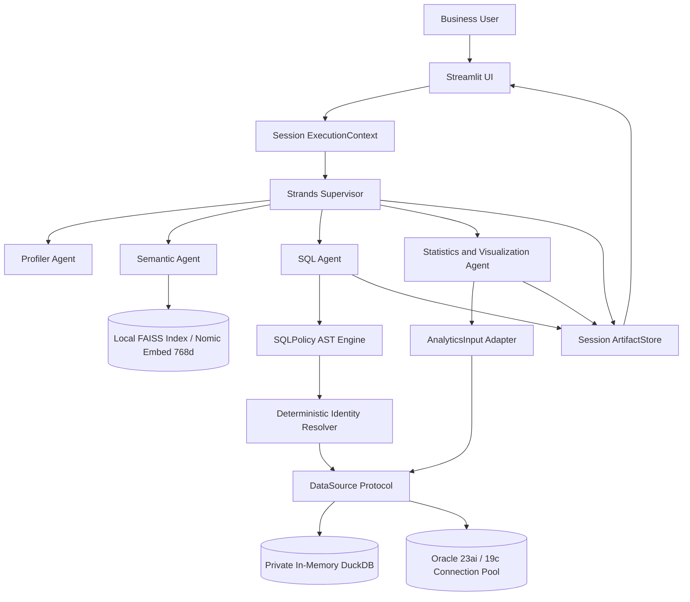

# Technical Reference & Implementation Specifications — Tabular Intelligence

## 1. Architectural Evolution

Tabular Intelligence has evolved from an initial prototype into a decoupled, session-isolated, multi-backend analytical framework.

---

## 2. Active Components & Concrete Responsibilities

| Component | Key Implementation Files | Runtime Behavior & Invariants |
| :--- | :--- | :--- |
| **Presentation Layer** | [`app.py`](app.py) | Streamlit dashboard, session binding, data-source selector, chat canvas, expandable SQL/trace drawers. |
| **Decoupled Contracts** | [`core/contracts.py`](core/contracts.py) | `DataSource` protocol, `QueryResult` envelope, `AnalyticsInput` adapter. Decouples agents from concrete database engines. |
| **Session Isolation** | [`core/execution_context.py`](core/execution_context.py) | Thread-safe contextvars and `SessionRegistry` managing private DuckDB instances, FAISS indexes, and artifact stores. |
| **SQL Security & AST** | [`core/sql_policy.py`](core/sql_policy.py) | `sqlglot` parser enforcing single-statement read-only execution, schema/table allowlisting, and dangerous function rejection. |
| **Identity Disambiguation** | [`core/identity_resolver.py`](core/identity_resolver.py) | Pre-query AST validator blocking ambiguous name queries on parent/child joins (DEF-02 resolution). |
| **Oracle Adapter** | [`core/oracle_engine.py`](core/oracle_engine.py), [`core/oracle_catalog.py`](core/oracle_catalog.py) | `python-oracledb` Thin-mode connection pool, dynamic data dictionary discovery, read-only transaction boundary. |
| **DuckDB Engine** | [`core/db_engine.py`](core/db_engine.py) | Isolated DuckDB analytical engine with automated header normalization and memory ceilings. |
| **Local Embeddings** | [`core/nomic_embeddings.py`](core/nomic_embeddings.py), [`core/semantic_index.py`](core/semantic_index.py) | Local Nomic-MoE embedding client (`:8088`) feeding FAISS `IndexFlatIP` with RapidFuzz fallback. |
| **Multi-Agent Swarm** | [`core/agents/`](core/agents/) | Strands `SupervisorAgent`, `ProfilerAgent`, `SemanticAgent`, `SQLAgent`, `StatsAgent`. |
| **Model Factory** | [`core/agents/llm_factory.py`](core/agents/llm_factory.py) | Amazon Bedrock primary adapter (STS assume role) with OpenRouter secondary development option. |

---

## 3. Decoupling & Inversion of Control

In previous iterations, statistical and visualization tools directly imported and invoked `DatabaseEngine.get_instance()`. In this release:
1. All query execution and numeric extraction route through `AnalyticsInput` and `resolve_data_source()`.
2. The active data source is dynamically obtained from the thread-local `ExecutionContext`.
3. Statistical metrics (`calculate_distribution_stats`, `detect_outliers_iqr_zscore`, `calculate_correlation_matrix`) and Plotly charts operate identically on both CSV uploads and live Oracle tables.
