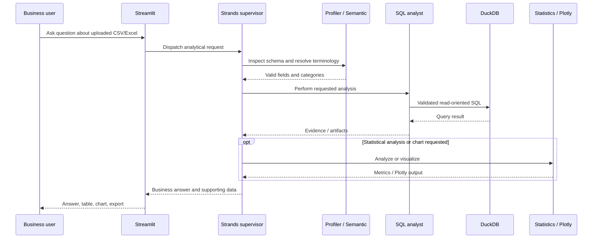

# Technical architecture — Tabular Intelligence MVP

## Verified code layout

| Layer | Implementation |
|---|---|
| UI | `app.py` — Streamlit conversational workspace |
| Supervisor | `core/agents/supervisor.py` — Strands agent orchestration |
| Profiler | `core/agents/profiler_agent.py` |
| Semantic resolver | `core/agents/semantic_agent.py`, `core/semantic_index.py`, `core/nomic_embeddings.py` |
| SQL analyst | `core/agents/sql_agent.py`, `core/tools/sql_tools.py` |
| Statistics/charts | `core/agents/stats_agent.py`, `core/tools/stats_tools.py`, `core/tools/viz_tools.py` |
| Analytical storage | `core/db_engine.py` — in-memory DuckDB |
| Model integration | `core/agents/llm_factory.py` — Strands `BedrockModel` via boto3 |
| Evidence | `core/tools/artifact_store.py` |

## Execution flow

## Data and model boundaries

- CSV, XLSX, and XLS uploads with an application-level 15 MB limit.
- Session-isolated in-memory DuckDB workspace for structured analysis.
- Nomic embedding endpoint configurable at `http://127.0.0.1:8088/v1`; FAISS semantic matching with RapidFuzz fallback.
- AWS Bedrock is configured through environment settings and the standard AWS credential chain or an assumed IAM role.
- SQL read-only checks are implemented in the supplied MVP; they are not a substitute for production database permissions and policy enforcement.
- External model prompts may include schema or sample-value context. Never use confidential data without provider, privacy, and access-control review.

## Known scope limits

The reviewed ZIP **does not implement Oracle connectivity**. There is no verified enterprise authentication, authorization, Oracle multi-table query planner, row-level security, or persistent governed data catalog. These belong to the proposed next phase, not the current MVP.

## Proposed Oracle phase

1. Add `python-oracledb` and an approved read-only Oracle connection.
2. Build a reviewed schema/foreign-key metadata catalog.
3. Route operational lookups to parameterized Oracle queries.
4. Route selected bounded analytical extracts to DuckDB, with freshness and completeness markers.
5. Add independent authorization, SQL validation, execution limits, and evidence verification.
6. Validate against Oracle 21c-compatible SQL and synthetic test records.

## Development validation

- Compile Python modules: `python -m compileall -q .`
- Run local benchmark: `python test_verification.py`
- Run Bedrock integration only in an authorized environment: `python test_bedrock_integration.py`
- Inspect logs, query artifacts, charts, and negative tests before claiming production readiness.

This document is based on the supplied source archive; implementation and runtime verification are separate concerns.
