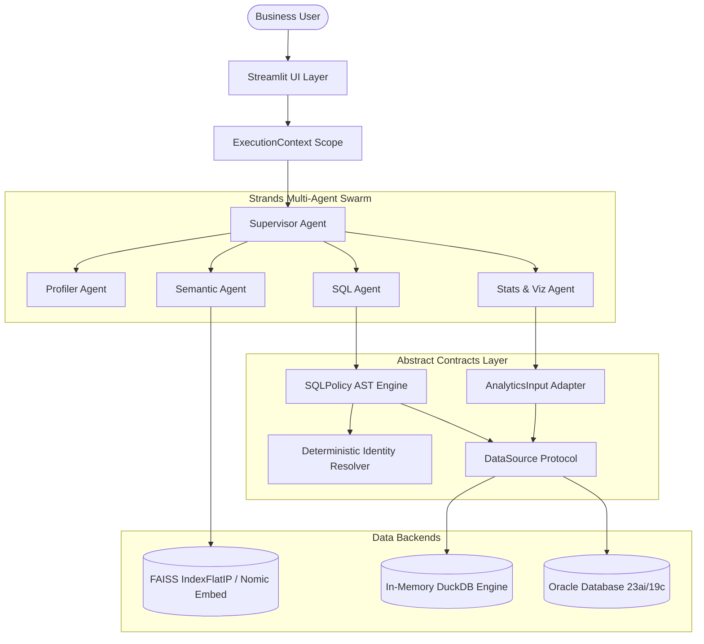
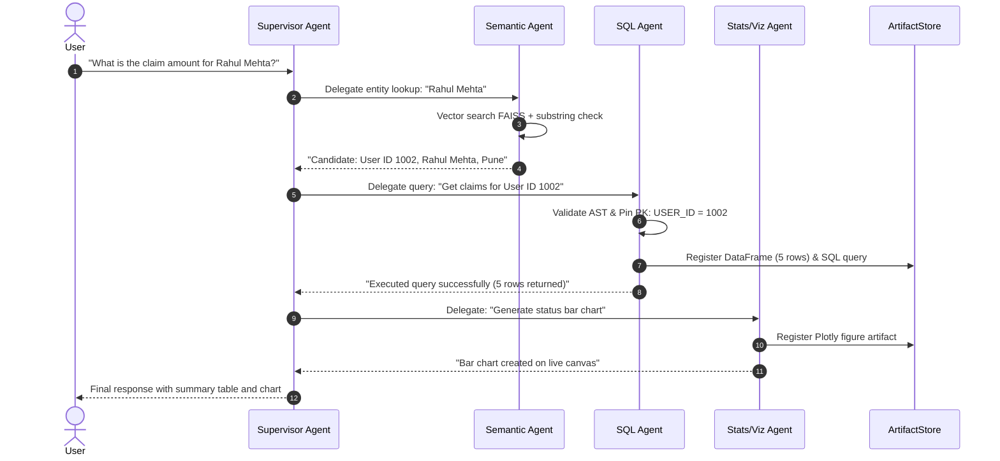
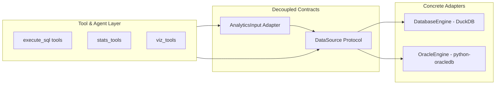
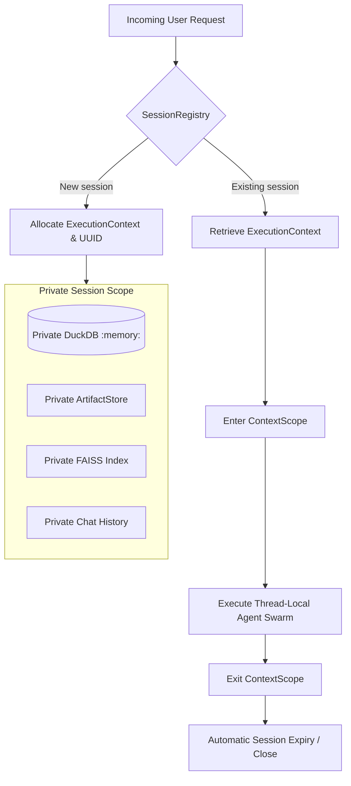
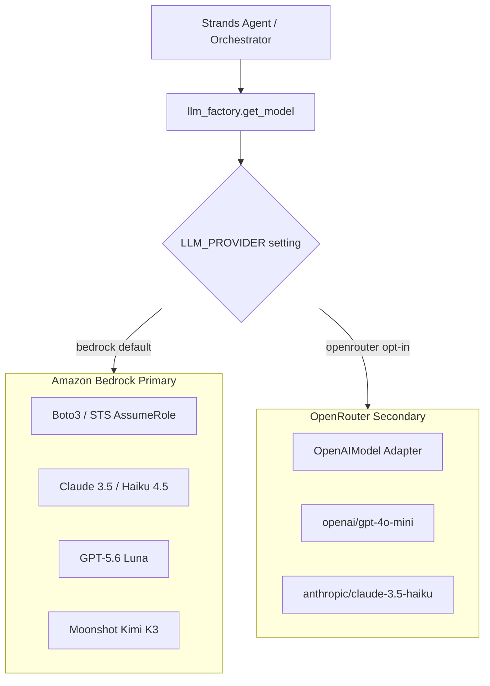

# Technical Architecture — Tabular Intelligence

## 1. System Overview

Tabular Intelligence is a conversational data analytics platform built on the **Strands Agents SDK**. It allows business analysts to query tabular spreadsheets (CSV/Excel) and live enterprise relational databases (Oracle) using plain English.

The system uses a **decoupled layered architecture** where user presentation, agent orchestration, query execution boundaries, and statistical computation operate against clean contracts rather than concrete database instances.

---

## 2. Architectural Diagrams

### Diagram A — High-Level System Architecture

---

### Diagram B — Strands Orchestration and Tool Delegation

---

### Diagram C — Database Adapter Boundaries

---

### Diagram D — Session Isolation and Execution Lifecycle

---

### Diagram E — Model Provider Abstraction

---

## 3. Active Module Inventory

| Module Path | Primary Responsibility | Direct Dependencies |
| :--- | :--- | :--- |
| [`app.py`](../app.py) | Streamlit presentation layer, state management, UI rendering, canvas drawers | Streamlit, ExecutionContext, Supervisor |
| [`config.py`](../config.py) | Global configuration, environment variables, timeouts, logging setup | python-dotenv |
| [`core/contracts.py`](../core/contracts.py) | Abstract `DataSource` protocol, `QueryResult` envelope, and `AnalyticsInput` adapter | pandas, numpy |
| [`core/execution_context.py`](../core/execution_context.py) | Session-scoped state isolation, database instances, and artifact lifecycle | contextvars, threading |
| [`core/sql_policy.py`](../core/sql_policy.py) | AST SQL validation, forbidden statement rejection, table/schema allowlisting | sqlglot, duckdb |
| [`core/identity_resolver.py`](../core/identity_resolver.py) | Deterministic entity disambiguation and AST pre-query check (DEF-02) | sqlglot, pandas |
| [`core/oracle_engine.py`](../core/oracle_engine.py) | Connection-pooled Oracle adapter, Thin mode, read-only transaction boundary | python-oracledb |
| [`core/oracle_catalog.py`](../core/oracle_catalog.py) | Dynamic data-dictionary discovery (`ALL_TABLES`, `ALL_CONSTRAINTS`, FK graph) | OracleEngine, pandas |
| [`core/db_engine.py`](../core/db_engine.py) | Isolated DuckDB database engine for uploaded spreadsheets with AST protection | duckdb, pandas |
| [`core/semantic_index.py`](../core/semantic_index.py) | FAISS `IndexFlatIP` vector store with RapidFuzz and substring fallback | faiss, rapidfuzz |
| [`core/nomic_embeddings.py`](../core/nomic_embeddings.py) | Local HTTP client connecting to Nomic embedding server on port 8088 | requests, numpy |
| [`core/agents/supervisor.py`](../core/agents/supervisor.py) | Strands supervisor coordinating specialist delegation and out-of-scope refusal | strands-agents |
| [`core/agents/sql_agent.py`](../core/agents/sql_agent.py) | SQL specialist generating dialect-specific queries with self-healing feedback | strands-agents, sql_tools |
| [`core/agents/stats_agent.py`](../core/agents/stats_agent.py) | Statistical computing specialist calculating distributions, outliers, and charts | strands-agents, stats_tools |
| [`core/agents/semantic_agent.py`](../core/agents/semantic_agent.py) | Resolves natural-language entity names to physical database primary keys | strands-agents, semantic_index |
| [`core/agents/profiler_agent.py`](../core/agents/profiler_agent.py) | Computes column metadata, data types, null percentages, and cardinality | strands-agents, profiling_tools |
| [`core/agents/llm_factory.py`](../core/agents/llm_factory.py) | Unified model provider factory with Bedrock primary and OpenRouter secondary | boto3, strands-agents |

---

## 4. Dependency Direction & Decoupling

A key achievement of this milestone is **strict inversion of dependencies**:
- High-level modules (the Streamlit UI, Supervisor Agent, and Stats Agent) **do not import or depend on `OracleEngine` or `duckdb`**.
- They interact strictly through `core/contracts.py` via `DataSource` and `AnalyticsInput`.
- At runtime, `ExecutionContext` inspects `ctx.data_source_type` and injects the appropriate concrete `DataSource` implementation.
- This ensures that introducing future databases (e.g. PostgreSQL or Snowflake) requires zero changes to the multi-agent swarm or visualization tools.
