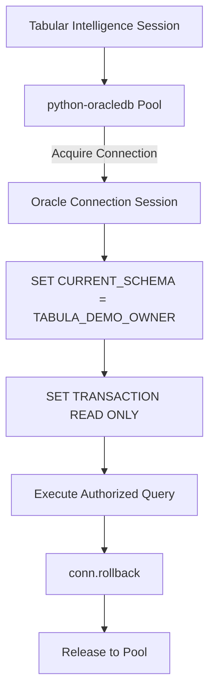
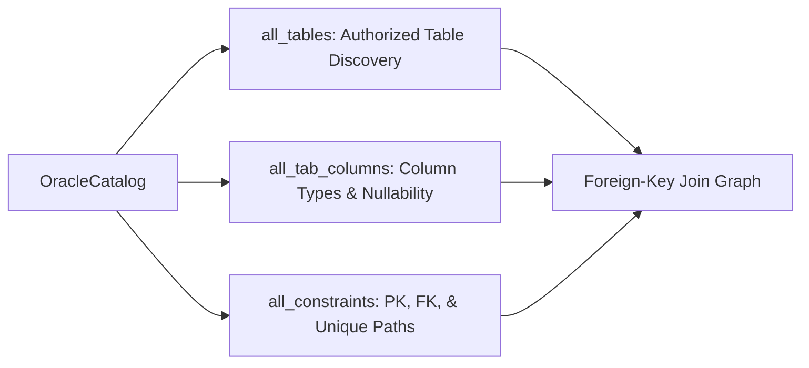

# Enterprise Database Integration — Oracle & DuckDB

## 1. Overview & Connection Architecture

Tabular Intelligence integrates direct Oracle relational database connectivity alongside its local DuckDB analytical engine. The integration uses **`python-oracledb`**, the official Python driver for Oracle Database.

### Pure Thin Mode Architecture
- **Zero Binary Dependencies**: By default, `python-oracledb` operates in pure Thin mode, eliminating the need for Oracle Instant Client binaries, C compiler dependencies, or complex environment configurations.
- **Optional Thick Mode**: Thick mode is supported via configuration (`ORACLE_MODE=thick`) if advanced legacy features (e.g., Oracle Advanced Security or continuous query notification) are required.
- **Connection Pooling**: Implements thread-safe connection pooling (`oracledb.create_pool`) with configurable minimum (default 1) and maximum (default 4) connections.



---

## 2. Supported Oracle Version Policy

| Oracle Version | Compatibility Status | Operational Notes |
| :--- | :--- | :--- |
| **Oracle 23ai (23.x)** | **Primary Verified Environment** | Tested against local Oracle 23ai Free (`127.0.0.1:1521/FREEPDB1`). |
| **Oracle 21c (21.x)** | **Compatible** | Full Thin mode support; supports modern pagination and CTE syntax. |
| **Oracle 19c (19.x)** | **Compatible (Long-Term Support)** | Recommended enterprise deployment target; full Thin mode support. |
| **Oracle 12c / 11g** | **Legacy / Limited Compatibility** | Requires Thick mode; lacks ANSI join optimizers and modern CTE syntax. |

### Rationale: Deliberate Non-Use of Oracle 23ai AI Features
Although developed and tested against Oracle 23ai Free, Tabular Intelligence **deliberately avoids Oracle 23ai database-resident AI features** (e.g. `DBMS_HYBRID_VECTOR`, database-resident LLMs, or in-database vector indexes).
- **Reasoning**: Many enterprise deployments operate on Oracle 19c LTS. Tying the application to 23ai-exclusive vector packages would break compatibility with 19c.
- **Separation of Concerns**: Vector embedding remains cleanly decoupled in local FAISS and Nomic-MoE, while Oracle serves purely as the enterprise relational data store.

---

## 3. Dynamic Schema Discovery & Catalog Construction

The [`OracleCatalog`](../core/oracle_catalog.py) dynamically inspects Oracle data dictionary views at runtime:



1. **Table Discovery**: Queries `all_tables` filtered by `owner = :schema_owner` and validated against `ORACLE_ALLOWED_TABLES`.
2. **Column Metadata**: Queries `all_tab_columns` to retrieve data types, scale, precision, and nullability.
3. **Relationship Mapping**: Queries `all_constraints` (`constraint_type = 'R'`) to discover foreign-key join relationships dynamically without manual configuration.

---

## 4. Query Execution & Security Policy

1. **AST Authorization Boundary**: All queries pass through `SQLPolicy` powered by `sqlglot`.
2. **Restricted Runtime User**: Operates exclusively under `TABULA_DEMO_RO`, possessing only `CREATE SESSION` and `SELECT` grants.
3. **Transaction Immutability**: Every transaction executes `SET TRANSACTION READ ONLY`. Any attempt to perform `INSERT`, `UPDATE`, `DELETE`, or DDL immediately triggers `ORA-01456: may not perform insert/delete/update operation inside a READ ONLY transaction`.
4. **Execution Timeouts**: A daemon thread timer cancels queries exceeding `ORACLE_TIMEOUT_SECONDS` (default 30s) via `conn.cancel()`.

---

## 5. Synthetic Fixture Verification

The test environment uses a synthetic multi-table insurance schema:

```sql
-- Schema Owner: TABULA_DEMO_OWNER
-- Runtime User: TABULA_DEMO_RO (Read-Only)

CREATE TABLE TABULA_DEMO_OWNER.USERS (
  USER_ID NUMBER(10) CONSTRAINT PK_USERS PRIMARY KEY,
  FULL_NAME VARCHAR2(120) NOT NULL,
  EMAIL VARCHAR2(200) NOT NULL CONSTRAINT UQ_USERS_EMAIL UNIQUE,
  CITY VARCHAR2(80) NOT NULL,
  JOINED_DATE DATE NOT NULL
);

CREATE TABLE TABULA_DEMO_OWNER.CLAIMS (
  CLAIM_ID NUMBER(10) CONSTRAINT PK_CLAIMS PRIMARY KEY,
  USER_ID NUMBER(10) NOT NULL,
  POLICY_NO VARCHAR2(40) NOT NULL,
  CLAIM_TYPE VARCHAR2(30) NOT NULL,
  CLAIM_AMOUNT NUMBER(12,2) NOT NULL,
  CLAIM_STATUS VARCHAR2(20) NOT NULL,
  FILED_DATE DATE NOT NULL,
  SETTLED_DATE DATE,
  CONSTRAINT FK_CLAIMS_USERS FOREIGN KEY (USER_ID) REFERENCES TABULA_DEMO_OWNER.USERS(USER_ID)
);
```

### Verified Database Truth
- **Total Users**: 30
- **Total Claims**: 70
- **Total Claim Amount**: ₹2,903,820.00
- **Rahul Candidate Disambiguation**:
  - `User 1001` (Rahul Sharma, Mumbai): 6 claims, ₹213,932.00
  - `User 1002` (Rahul Mehta, Pune): 5 claims, ₹132,511.00
  - `User 1003` (Rahul Sharma, Delhi): 4 claims, ₹181,850.00
- **Zero-Claim Users**: 3 (IDs: 1028, 1029, 1030)
