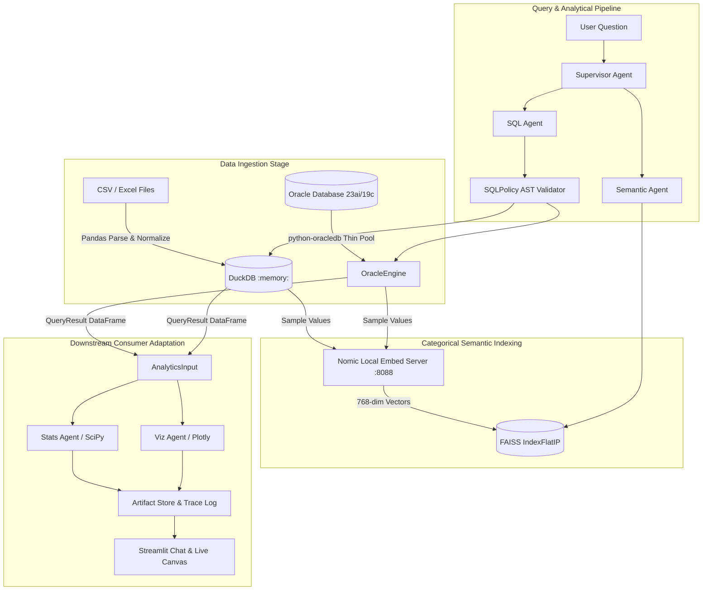

# Data Flow Architecture & Lineage — Tabular Intelligence

## 1. End-to-End Data Lineage

---

## 2. Ingestion & Storage Boundaries

### Spreadsheets (CSV & Excel)
- Uploaded files are ingested via `pandas.read_csv()` / `read_excel()`.
- Headers are automatically normalized (`core/db_engine.py:normalize_column_name`) to eliminate spaces, hyphens, and leading numbers.
- Ingested data is registered into a private in-memory DuckDB instance tied exclusively to the active `ExecutionContext`.

### Relational Database (Oracle)
- Data remains resident within the Oracle database.
- Queries are executed using read-only transaction snapshots (`SET TRANSACTION READ ONLY`).
- Results are fetched into standardized `pandas.DataFrame` envelopes governed by strict row limits (default 5,000 rows for analysis; 15 rows for textual preview).

---

## 3. Data Completeness & Truncation Guards

To prevent silent truncation errors (where metrics might be computed on a truncated subset of rows):
- **Full Population Processing**: Aggregations (`SUM`, `AVG`, `COUNT`) and statistical metrics are executed directly within the SQL engine over the full population.
- **Analytical Completeness Test**: Verified via `tests/offline/test_data_correctness.py` on 10,000 rows without row truncation.
- **Preview Clamping**: Only the textual display returned to the LLM context is capped (at 15 rows) to conserve tokens, while the full result dataset is stored in the session context.

---

## 4. External Inference Exposure Boundaries

> [!IMPORTANT]
> **Data Privacy Disclaimer**: Tabular Intelligence does **not** claim zero external data transfer when cloud model inference (Amazon Bedrock or OpenRouter) is active.

### What is sent to external LLM providers:
1. **Schema Metadata**: Table names, column names, and column data types.
2. **Distinct Categorical Samples**: Top 2–3 representative distinct values (used for schema disambiguation prompts).
3. **Query Previews**: Up to 15 preview rows of query results for natural-language summarization.
4. **User Prompts**: The conversational question entered by the user.

### What is NEVER sent to external LLM providers:
1. **Full Database Tables**: Underlying database tables remain strictly local in DuckDB or Oracle.
2. **Database Credentials**: Passwords, usernames, and connection strings are strictly consumed by `python-oracledb` and never exposed in prompts or logs.
3. **FAISS Vector Embeddings**: Embeddings are computed locally on `http://127.0.0.1:8088/v1` and queried in local memory via FAISS.
