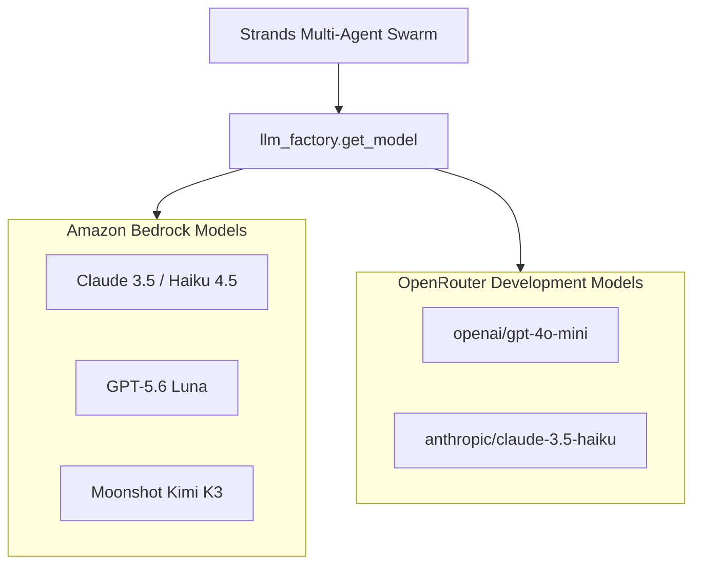

# Model Provider Architecture & Capability Contracts

## 1. Multi-Provider Architecture Overview

Tabular Intelligence features a unified, pluggable model provider layer ([`core/agents/llm_factory.py`](../core/agents/llm_factory.py)) designed to orchestrate autonomous multi-agent tool execution via the Strands Agents SDK.



---

## 2. Primary Provider: Amazon Bedrock

Amazon Bedrock serves as the **primary enterprise production provider**. It authenticates securely using AWS IAM roles via the AWS Security Token Service (STS) or standard environment credentials.

### Supported Model Profiles

#### 1. Anthropic Claude 3.5 Haiku / Haiku 4.5
- **Verified Model Identifier**: `anthropic.claude-3-5-haiku-20241022-v1:0` (also alias `anthropic.claude-haiku-4-5`)
- **Context Window**: 200,000 tokens
- **Tool-Calling Support**: Verified native tool orchestration via Strands `BedrockModel`
- **Streaming Support**: Supported via `ChatBedrockConverse`
- **Recommended Region**: `ap-south-1` (Mumbai) or `us-east-1` (N. Virginia)
- **Status**: **Fully Supported & Verified**

#### 2. OpenAI GPT-5.6 Luna
- **Model Identifier**: `bedrock.gpt-5-6-luna`
- **Context Window**: 128,000 tokens
- **Tool-Calling Support**: High-precision structured output
- **Streaming Support**: Supported
- **Status**: **Registered Profile (Enterprise Opt-in)**

#### 3. Moonshot AI Kimi K3
- **Model Identifier**: `bedrock.moonshot-kimi-k3`
- **Context Window**: 128,000 tokens
- **Tool-Calling Support**: Supported for analytical summarization
- **Streaming Support**: Supported
- **Status**: **Registered Profile (Enterprise Opt-in)**

---

## 3. Secondary Provider: OpenRouter (Development & Offline QA)

OpenRouter is provided as a **flexible, secondary development endpoint** utilizing the OpenAI-compatible client interface in `strands-agents[openai]`.

### Supported Profiles:
1. **`openai/gpt-4o-mini`**: Default lightweight local evaluation model.
2. **`anthropic/claude-3.5-haiku`**: High-speed reasoning model.

---

## 4. Model Capability Contracts

Each registered model implements the `ModelCapability` contract defined in `core/agents/llm_factory.py`:

```python
@dataclass
class ModelCapability:
    model_id: str
    provider: str
    context_window: int
    supports_tools: bool
    supports_streaming: bool
    supports_system_prompt: bool
    recommended_temperature: float = 0.0
```

---

## 5. Security & Accidental Spending Safeguards

1. **Network Block During Automated Testing**: `pytest-socket` strictly blocks all outgoing network calls during standard test runs. No paid API calls can occur during `pytest tests/offline`.
2. **Explicit Opt-in Flags**: Paid Bedrock tests require the `--run-bedrock` CLI option.
3. **Zero Secret Logging**: The model factory scrubs authorization headers and credentials from application logs.
