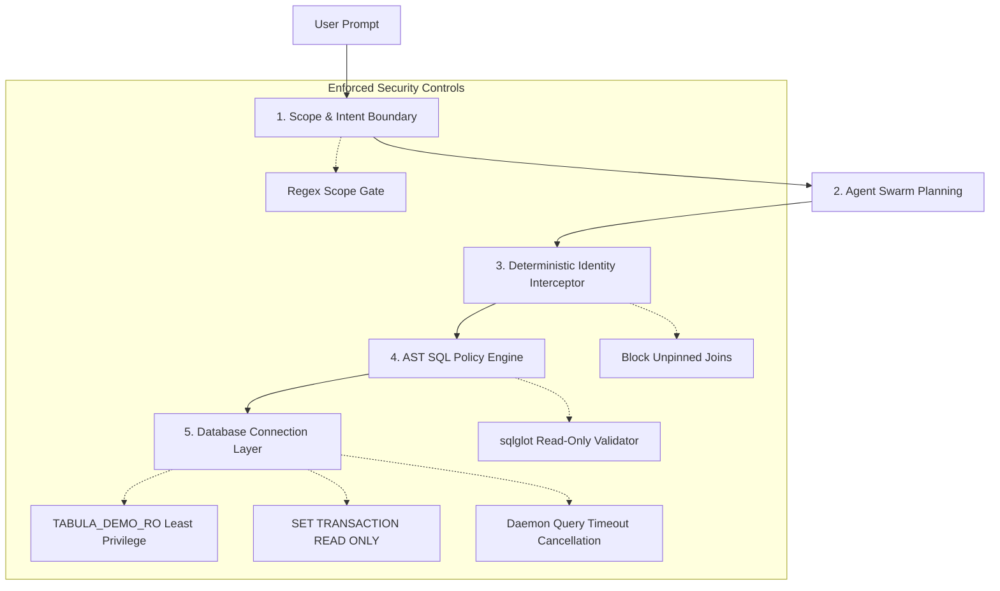

# Security Architecture & Hardening Controls — Tabular Intelligence

## 1. Multi-Layer Defense-in-Depth Model

Tabular Intelligence implements a multi-layer security architecture to ensure complete isolation, read-only database immutability, and prompt injection defense.

---

## 2. Implemented Security Controls

### 1. Database Read-Only Isolation
- **Restricted Database Role**: The application connects exclusively through the `TABULA_DEMO_RO` user account, which possesses only `CREATE SESSION` and `SELECT` grants on specific views/tables.
- **Transaction-Level Guard**: All Oracle transactions execute `SET TRANSACTION READ ONLY`. Any attempt to perform DML (`INSERT`, `UPDATE`, `DELETE`) or DDL (`CREATE`, `DROP`, `ALTER`) fails at the database engine level with `ORA-01456`.

### 2. AST-Based SQL Policy (`SQLPolicy`)
All queries are parsed into Abstract Syntax Trees (AST) using `sqlglot` prior to execution:
- **Forbidden Statements**: Strictly blocks `Create`, `Drop`, `Insert`, `Update`, `Delete`, `Alter`, `Command`, `Transaction`, `Commit`, `Rollback`, `Set`, `Pragma`, `Copy`, `Attach`, `Detach`, `Install`, `Merge`, and `TruncateTable`.
- **System Procedure Blacklist**: Blocks all dangerous Oracle packages (`DBMS_*`, `UTL_*`, `CTXSYS`, `SYS`).
- **Forbidden Functions**: Blocks all DuckDB file-reading or export functions (`read_csv`, `read_parquet`, `copy`, `export`, `httpfs`, etc.).
- **Single-Statement Enforcement**: Blocks semicolon-separated multi-statement query chaining.

### 3. Object & Schema Allowlisting
- Queries are verified against explicit allowlists (`ORACLE_ALLOWED_SCHEMAS`, `ORACLE_ALLOWED_TABLES`).
- Schema qualification (e.g. `SYS.ALL_USERS`) is strictly rejected if not in the approved schema list.

### 4. Deterministic Entity Disambiguation (DEF-02)
- Implements `core/identity_resolver.py`.
- Intercepts queries joining child tables (e.g. `CLAIMS`) based on entity names (e.g. `Rahul`) without pinning a single primary key.
- If $> 1$ distinct entities match, execution is **strictly blocked at the AST boundary** and a structured candidate list is returned to demand user clarification.

### 5. Session Isolation & Process Boundary
- Implemented via `core/execution_context.py` and `SessionRegistry`.
- Each user session owns an isolated in-memory DuckDB instance, an isolated `ArtifactStore`, and private FAISS vector indexes.
- No session can query or inspect tables registered by another concurrent session.

### 6. Query Execution Deadlines & Timeout Budgets
- Queries are executed under strict deadlines (`ORACLE_TIMEOUT_SECONDS = 30.0`).
- A background daemon thread issues `conn.cancel()` if query execution exceeds the time limit.

---

## 3. Credential Hygiene & Secret Scrubbing

1. **Zero Hardcoded Passwords**: Source code and `.env.example` contain zero plaintext passwords or live API keys.
2. **Git Exclusion**: `.env`, `.env.*`, `*.bak`, `data/*.db`, and `scratch/` are strictly excluded via `.gitignore`.
3. **Log Sanitization**: Application logs scrub authentication headers and credentials.

---

## 4. Unsupported Security Features & Honest Boundaries

> [!WARNING]
> **Enterprise Row-Level Security (RLS)**: Tabular Intelligence currently enforces table-level authorization and deterministic identity clarification. It does **not** implement enterprise user-level Row-Level Security (RLS) or Active Directory integration. All users sharing a session connect through the configured read-only database service account.
