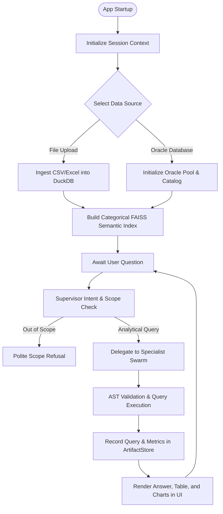
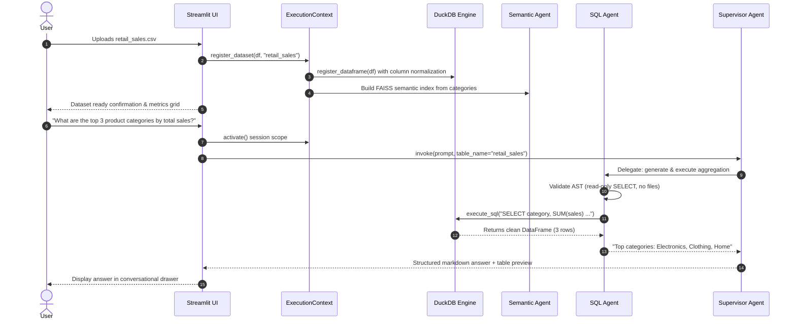
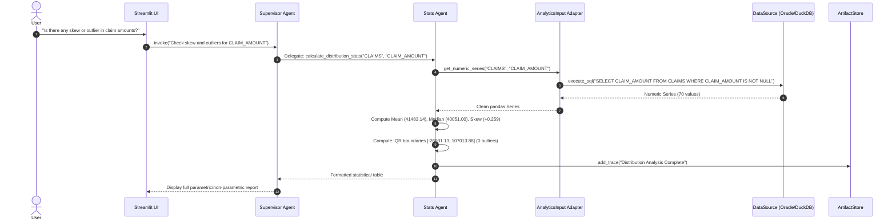
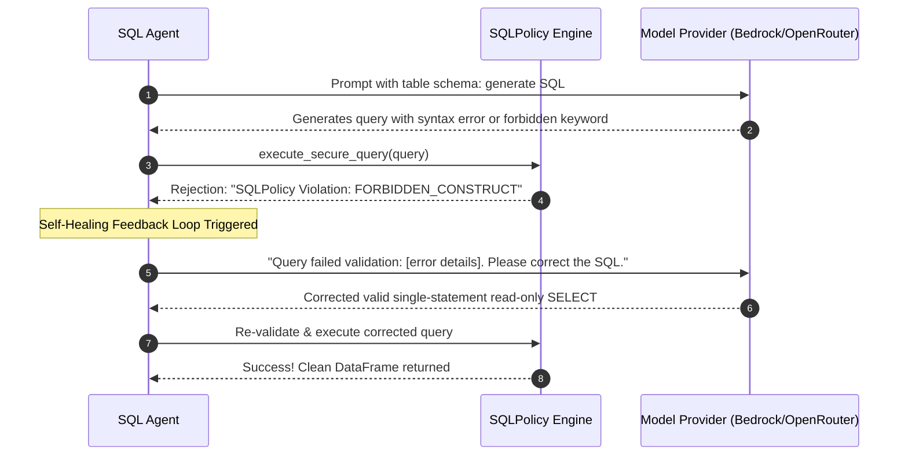
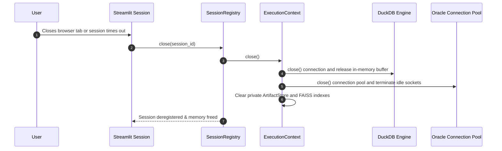

# Execution Workflows — Tabular Intelligence

## 1. System Execution Lifecycle

Tabular Intelligence follows a deterministic, state-isolated execution lifecycle across all analytical interactions.



---

## 2. Sequence Diagrams

### 1. CSV/Excel Analytical Request Workflow



---

### 2. Oracle Relational Lookup Workflow

```mermaid
sequenceDiagram
    autonumber
    actor User
    participant UI as Streamlit UI
    participant Ctx as ExecutionContext
    participant Ora as Oracle Engine
    participant Cat as Oracle Catalog
    participant Res as Identity Resolver
    participant SQL as SQL Agent
    participant Sup as Supervisor Agent

    User->>UI: Selects "Oracle Database" & clicks Connect
    UI->>Ctx: register_oracle_source()
    Ctx->>Ora: Create connection pool (min=1, max=4)
    Ctx->>Cat: discover_metadata() via ALL_TABLES, ALL_CONSTRAINTS
    Cat-->>Ctx: Schema catalog with foreign keys (USERS <-> CLAIMS)
    UI-->>User: Connected status (23ai Thin Mode)

    User->>UI: "Show all claims for Rahul Mehta"
    UI->>Sup: invoke("Show all claims for Rahul Mehta")
    Sup->>SQL: Delegate query formulation
    SQL->>Res: Pre-query check: Does filter match multiple entities?
    Res->>Ora: SELECT USER_ID FROM USERS WHERE LOWER(FULL_NAME) LIKE '%rahul mehta%'
    Ora-->>Res: Exactly 1 record (USER_ID = 1002) -> Unambiguous!
    SQL->>Ora: SET TRANSACTION READ ONLY; SELECT * FROM CLAIMS WHERE USER_ID = 1002
    Ora-->>SQL: 5 claim records
    SQL-->>Sup: Formatted markdown table preview
    Sup-->>UI: Render response with verified policy trace
```

---

### 3. Statistical Analysis Workflow



---

### 4. Model-Provider Error Recovery & Self-Healing Workflow



---

### 5. Resource Cleanup and Session Teardown


